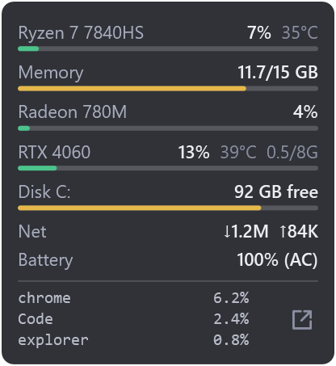

# MiniDash

[日本語](#日本語) | [English](#english)

## 日本語

タスクマネージャーを開かなくても、画面の右下でPCの状態をひと目で確認できる、Windows用の小さなシステムモニターです。

### 表示される内容（2秒ごとに更新）

- **CPU**：製品名、使用率、温度（内蔵GPUがあるCPUの場合）
- **Memory**：使用量／搭載量
- **GPU**：GPUごとの製品名、使用率、温度、専用メモリ（NVIDIA・AMD・Intel）。GPUが検出できないPCでは表示されません
- **Disk**：システムドライブの空き容量
- **Net**：下り／上りの通信速度
- **Battery**：残量（ノートPCのみ）
- **CPUを多く使っているアプリ上位3つ**（同じ名前のプロセスは合算）

バーの色は使用率で変わります（60%未満は緑、85%未満は黄、それ以上は赤）。

### インストール

1. 右上の **Code → Download ZIP** でダウンロードします。
2. ZIPファイルを右クリック →「プロパティ」→ 下の方の **「許可する」** にチェック → OK
   （これをしないと、実行時にWindowsの警告が出ることがあります）
3. ZIPを好きな場所に展開します（例：ドキュメント）。
4. 展開したフォルダの **`はじめに実行.cmd`** をダブルクリックします。

これで右下にMiniDashが表示され、次回からはPCを起動したときに自動で表示されます。

> 展開したフォルダは、インストール後も消したり移動したりしないでください。
> 移動した場合は、移動先で `はじめに実行.cmd` をもう一度実行してください。

### 操作

| 操作 | 動作 |
|---|---|
| ドラッグ | 好きな位置に移動（位置は記憶されます） |
| ランキング右のアイコン／ダブルクリック | タスクマネージャーを開く |
| 右クリック | 右下に戻す・常に手前に表示の切り替え・閉じる |

### アンインストール

フォルダ内の **`アンインストール.cmd`** をダブルクリックすると、MiniDashを終了し、自動起動と設定を削除します。そのあとフォルダごと削除してください。

### 動作環境

- Windows 10 / 11
- 追加のインストールは不要です（Windows標準のPowerShellと.NETだけで動きます）
- 管理者権限は不要です

### うまく動かないとき

`MiniDash_debug.cmd` を実行すると、エラーが画面に表示されます。エラーの記録は `%APPDATA%\MiniDash\error.log` にも残ります。

### 温度について

- GPU温度は、タスクマネージャーと同じ仕組み（D3DKMT）で取得しています。
- CPU温度は、CPUに内蔵されたGPUの温度を表示しています。CPUと同じチップのため、チップ全体のおおよその温度として使えます。CPUコアの正確な温度は、管理者権限で動く専用ドライバーが必要なため表示していません。内蔵GPUのないCPUでは、CPU温度は表示されません。

## English

A tiny always-on-top system monitor for Windows that sits in the bottom-right corner of your screen, so you can check your PC at a glance without opening Task Manager.

### What it shows (updated every 2 seconds)

- **CPU**: model name, usage, and temperature (on CPUs with integrated graphics)
- **Memory**: used / installed
- **GPU**: model name, usage, temperature, and dedicated memory for each GPU (NVIDIA, AMD, Intel). Hidden if no GPU is detected
- **Disk**: free space on the system drive
- **Net**: download / upload speed
- **Battery**: charge level (laptops only)
- **Top 3 apps by CPU usage** (processes with the same name are combined)

Bar colors change with load: green below 60%, yellow below 85%, red above.

### Install

1. Click **Code → Download ZIP** at the top right of this page.
2. Right-click the ZIP → **Properties** → check **Unblock** at the bottom → OK
   (otherwise Windows may show a security warning when you run it).
3. Extract the ZIP anywhere you like (e.g. Documents).
4. Double-click **`はじめに実行.cmd`** ("run this first") in the extracted folder.

MiniDash appears in the bottom-right corner and will start automatically every time you sign in.

> Don't delete or move the extracted folder after installing.
> If you do move it, run `はじめに実行.cmd` again from the new location.

### Controls

| Action | Result |
|---|---|
| Drag | Move it anywhere (the position is remembered) |
| Icon next to the app ranking / double-click | Open Task Manager |
| Right-click | Snap back to the corner, toggle always-on-top, close |

### Uninstall

Double-click **`アンインストール.cmd`** ("uninstall") in the folder. It stops MiniDash and removes auto-start and its settings. Then delete the folder.

### Requirements

- Windows 10 / 11
- Nothing else to install: it runs on the PowerShell and .NET that come with Windows
- No administrator rights needed

### Troubleshooting

Run `MiniDash_debug.cmd` to see any error on screen. Errors are also logged to `%APPDATA%\MiniDash\error.log`.

### About temperatures

- GPU temperature is read the same way Task Manager does it (D3DKMT).
- CPU temperature comes from the integrated GPU, which sits on the same chip as the CPU, so it gives a good estimate of the chip temperature. Exact per-core temperatures need a kernel driver running with administrator rights, so MiniDash doesn't show them. On CPUs without integrated graphics, no CPU temperature is shown.

## ライセンス / License

MIT License
